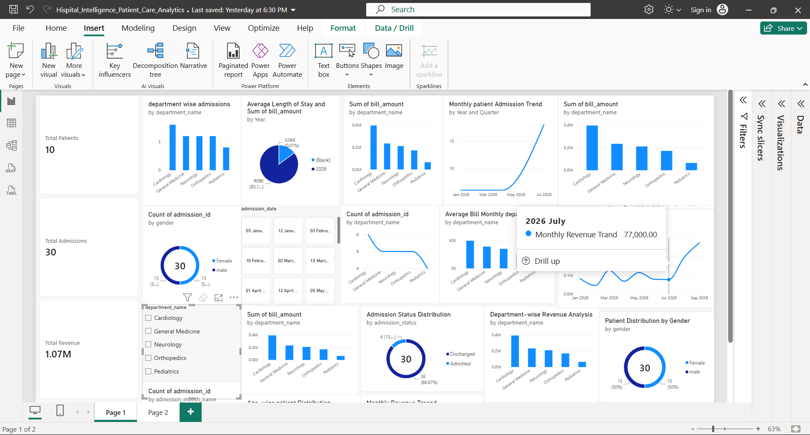
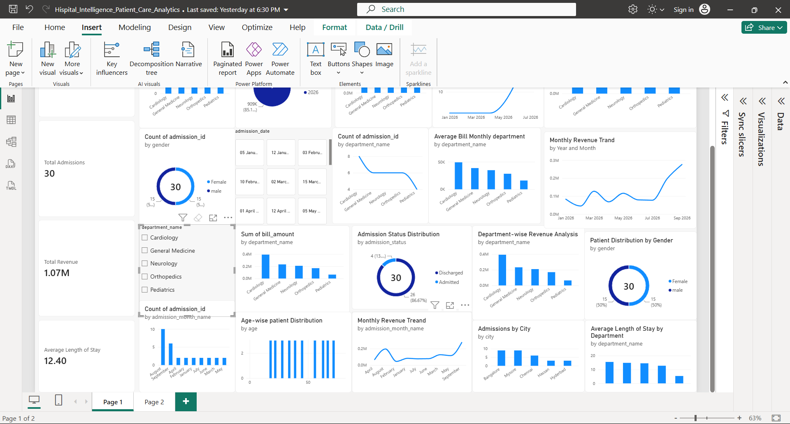
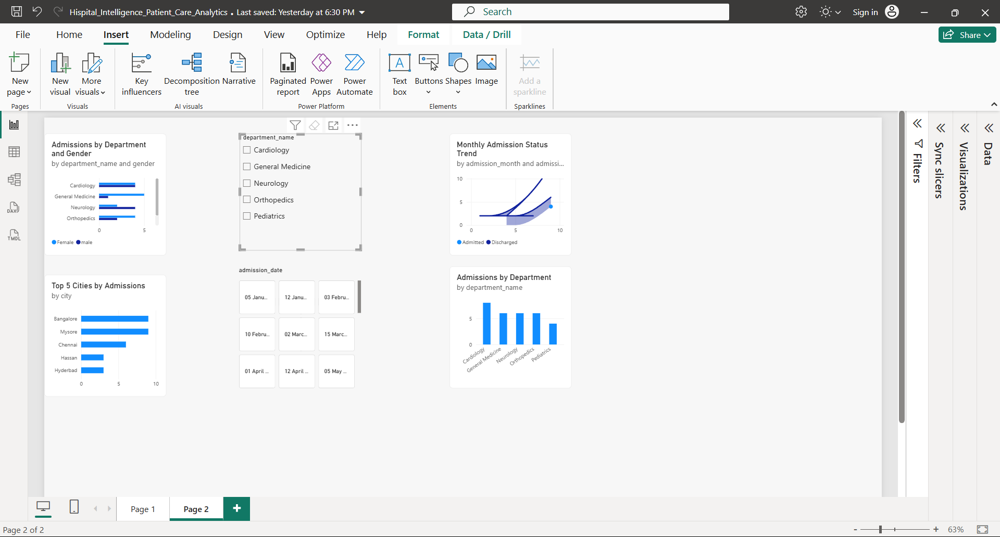

 # Hospital Intelligence & Patient Care Analytics
![POWER BI ]Click here for POWER BI Link - (https://app.powerbi.com/groups/me/reports/44d261e5-d165-426e-ad74-b75aa0627557/7f6d9429c400e9a350dc?experience=power-bi)
## Project Overview
Hospital Intelligence & Patient Care Analytics is a data analytics project designed to analyze hospital admissions, patient information, departmental performance, length of stay, and revenue.

The project uses **MySQL** for data storage and SQL-based analysis and **Microsoft Power BI** for data visualization and dashboard development.

## Objectives
- Analyze hospital admission patterns.
- Understand patient demographics and distribution.
- Monitor department-wise admissions.
- Analyze admission trends over time.
- Evaluate patient length of stay.
- Explore hospital revenue and billing data.
- Build an interactive dashboard to support data-driven decision-making.
- 

## Tools & Technologies
- MySQL
- SQL
- Microsoft Power BI
- DAX
- Data Visualization
- 

## Database Structure

The project uses the following tables:

| Table | Description |
|---|---|
| `patients` | Contains patient information, including patient ID, name, age, gender, and city. |
| `admissions` | Contains admission records, patient IDs, department IDs, admission dates, discharge dates, and bill amounts. |
| `departments` | Contains department IDs and department names. |


## SQL Analysis

SQL was used for data exploration, analysis, and preparing data for visualization.

Concepts used:
- SELECT, WHERE, ORDER BY
- GROUP BY and aggregate functions
- Joins
- Subqueries
- Common Table Expressions (CTEs)
- UNION
- Window Functions
- Date Functions
- NULL handling
- Conditional logic

## Power BI Dashboard

The interactive dashboard provides insights into hospital operations and patient care through visualizations and KPI indicators.

Dashboard analysis includes:
- Admission statistics
- Patient analysis
- Admission status distribution
- Department-wise analysis
- Monthly admission trends
- Length of stay analysis
- Revenue analysis

## Project Structure

```text
Hospital-Intelligence-Patient-Care-Analytics/
│
├── Hospital_Intelligence_Patient_Care_Analytics.pbix
│
├── SQL/
│   └── hospital_analytics.sql
│
├── Screenshots/
│   ├── dashboard_page1.png
│   └── dashboard_page2.png
│
└── README.md
```

## Key Learning Outcomes

- Practical application of SQL for data analysis.
- Working with relational databases and joins.
- Analyzing data using aggregate functions and window functions.
- Creating interactive dashboards using Power BI.
- Developing KPIs and data visualizations.
- Connecting SQL data with Power BI for analytical reporting.

## Author

**Ranjini M**

BCA Graduate | Aspiring Data Analyst
